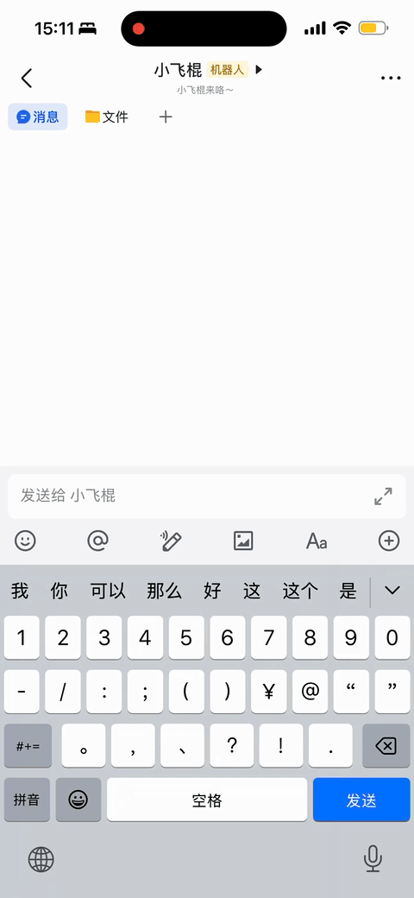
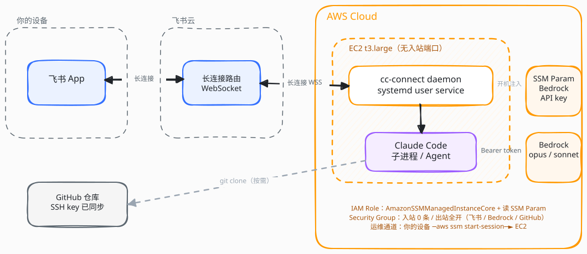

# cc-connect on AWS

> 个人实验项目 / Personal experiment — 不构成生产部署建议，使用前请自己评估。

把 [cc-connect](https://github.com/chenhg5/cc-connect) 部署到 AWS EC2，用飞书机器人远程操作 Claude Code，模型走 Amazon Bedrock。

<table align="center">
  <tr>
    <td align="center"></td>
    <td align="center"></td>
  </tr>
  <tr>
    <td align="center"><sub>飞书里跟 Claude Code 对话</sub></td>
    <td align="center"><sub>用 cc-connect 自带的 <code>/model</code> 卡片在 Bedrock 模型间切换<br/>（白名单 alias 由本仓库脚本写入 config.toml）</sub></td>
  </tr>
</table>

- ☁️ EC2 + 默认 VPC，t3.large
- 🔒 无入站端口（通过 SSM Session Manager 运维）
- 🔑 Bedrock API key 存在 SSM SecureString，机器开机时自动注入
- 🤖 Claude Code 通过 `AWS_BEARER_TOKEN_BEDROCK` 调 Bedrock
- 💬 飞书 WebSocket 长连接，无需公网 IP
- 🔁 EC2 上的 git/SSH 配置和本地保持一致，可 clone 私有仓库

## 架构



<details>
<summary>ASCII 备份（图加载失败时看这个）</summary>

```
你的飞书 ──长连接──► 飞书云 ──长连接──► EC2(cc-connect daemon)
                                          │
                                          ├─► Claude Code (子进程)
                                          │     └─► Amazon Bedrock (Claude Sonnet/Haiku)
                                          │
                                          └─► git clone (走本地同步过去的 SSH key)
```

</details>

## 先决条件

- AWS 账号，配好 AWS CLI（`aws sts get-caller-identity` 能返回身份）
- 在目标区域（默认 `us-east-1`）的 Bedrock 控制台已申请并通过 Claude Sonnet/Haiku 的 model access
- 一个 Bedrock 长期 API key（[官方文档](https://docs.aws.amazon.com/bedrock/latest/userguide/api-keys-generate.html)）
- 飞书自建应用：拿到 `app_id` 和 `app_secret`，开启机器人能力，订阅 `im.message.receive_v1` 和 `card.action.trigger`，发布版本（详见 [docs/feishu.md](https://github.com/chenhg5/cc-connect/blob/main/docs/feishu.md)）
- 本地有 GitHub SSH key（`~/.ssh/id_ed25519`），并已加入 GitHub 账号

## 文件清单

| 文件 | 作用 |
|---|---|
| `cc-connect-stack.yaml` | CloudFormation 模板：EC2 + IAM + SG + SSM Parameter；装 Claude Code/Codex/cc-connect（版本钉定），机型默认 m8i.2xlarge（参数化） |
| `sync-github-config.sh` | 把本地 GitHub SSH key 与 git 全局配置同步到 EC2 |
| `setup-codex.sh` | 写 `~/.codex/config.toml` + tavily MCP 包装脚本（tavily key 走 SSM）；**先于** setup-agents 运行 |
| `setup-agents.sh` | 写**双 project** config.toml（Claude Code + Codex，各自飞书 App / 模型白名单 / 默认模型）并启动 daemon |
| `configure-autorestart.sh` | 把 systemd `Restart=on-failure` 升级成 `Restart=always` + 崩溃循环保护，让 daemon 任何退出都自动拉起 |
| `set-model.sh` | 命令行一键切换 Bedrock 模型（不进飞书的备用通道） |
| `setup-feishu.sh` / `configure-models-and-admin.sh` | 旧的**单 project** 脚本（仅 Claude Code）。双 agent 部署请用上面的 `setup-codex.sh` + `setup-agents.sh` |
| `fix-claude-bedrock-env.sh` | 给 systemd service 注入 Bedrock 环境变量（备用，已固化进 user-data） |

## 部署流程

### 1. 先写入 Bedrock API key（**必须在部署栈之前**）

CloudFormation 不能创建 `SecureString` 类型的 SSM Parameter，所以 Bedrock 长期 key 要先手工 put 进去。EC2 启动时 user-data 会读这个参数；如果跳过这一步直接部署，user-data 拉不到 key，service 起不来。

```bash
aws ssm put-parameter \
  --name /cc-connect/bedrock-api-key \
  --value "你的 Bedrock API key" \
  --type SecureString \
  --region us-east-1
```

### 2. 部署基础设施

```bash
# 取默认 VPC 和一个默认子网
VPC_ID=$(aws ec2 describe-vpcs --filters Name=isDefault,Values=true \
  --region us-east-1 --query 'Vpcs[0].VpcId' --output text)
SUBNET_ID=$(aws ec2 describe-subnets \
  --filters Name=vpc-id,Values=$VPC_ID Name=default-for-az,Values=true \
  --region us-east-1 --query 'Subnets[0].SubnetId' --output text)

aws cloudformation deploy \
  --template-file cc-connect-stack.yaml \
  --stack-name cc-connect \
  --region us-east-1 \
  --capabilities CAPABILITY_IAM \
  --parameter-overrides VpcId=$VPC_ID SubnetId=$SUBNET_ID
```

栈创建后会输出 `InstanceId`、连接命令、SSM 参数名。

> ⚠️ **user-data 只在 EC2 首次 boot 执行**。如果以后用 `aws cloudformation deploy` 升级栈，模板里的 `npm install -g cc-connect` 等命令不会重跑；想升级 cc-connect 或 Claude Code，请通过 SSM Run-Command 在已运行的实例上执行 `npm install -g cc-connect@latest`。

### 3. 同步本地 GitHub 配置到 EC2

```bash
./sync-github-config.sh
```

脚本会：
- 把 `~/.ssh/id_ed25519` 和 `id_ed25519.pub` 经 SSM SecureString 加密上传
- 临时给 EC2 IAM Role 赋读权限
- 通过 SSM Run-Command 在 EC2 上写入 `~ec2-user/.ssh/`、配置 `~/.ssh/config`、固化 `known_hosts`、设置 `git config --global user.name/user.email`
- 撤销临时 IAM 权限并删除 SSM 参数

完成后 EC2 上 `git clone git@github.com:...` 等价于在你本地 clone。

### 4. 配置飞书并启动 daemon

cc-connect 的模型是 **One process, multiple projects** —— 一个进程跑多个 project，每个 project 是「一个 agent + 一个飞书 App」的组合。本仓库示范两个 project：一个跑 **Claude Code**（走 Bedrock），一个跑 **Codex**（走 Bedrock Mantle），各用一个独立飞书 App，互不干扰。

> 单 agent（只要 Claude Code）可以用旧脚本 `./setup-feishu.sh <app_id> <app_secret>`，更简单。下面是双 agent 流程。

先把 Tavily key（给 Codex/Claude 的搜索 MCP 用）放进 SSM：

```bash
aws ssm put-parameter --name /cc-connect/tavily-api-key \
  --value "<你的 tavily key>" --type SecureString --region us-east-1
```

然后**先**配 Codex 侧（写 `~/.codex/config.toml` + Tavily MCP 包装），**再**写双 project 配置并启动：

```bash
./setup-codex.sh
./setup-agents.sh <admin_open_id> <claude_app_id> <claude_app_secret> <codex_app_id> <codex_app_secret>
```

`setup-agents.sh` 会：
- 把两个飞书 App 凭证经加密 SSM 参数上传，临时授权 EC2 读取，用完即删
- 在 EC2 上写**双 project** `~/.cc-connect/config.toml`（含模型白名单、默认模型、`admin_from`/`allow_from`）
- `cc-connect daemon install/restart`，输出状态和日志尾部

成功后日志会出现 `cc-connect is running projects=2`，以及**两行** provider 激活：`claudecode: provider switched provider=bedrock` 和 `codex: provider switched provider=bedrock-mantle`（两行都出现才说明两个 agent 都正确激活了 provider，见下方「已知坑」）。

### 5. 在飞书里测试

在飞书工作台搜机器人 → 单聊发消息：

```
hi
```

第一次对话 Claude Code 会启动一个会话回复你。然后试试代码分析：

```
帮我 clone https://github.com/chenhg5/cc-connect 到当前目录，简要分析整体架构
```

### 6. 模型白名单 + 锁管理员（已包含在 setup-agents.sh 里）

上面的 `setup-agents.sh` 已经把这些一并写好了——它需要你的 `admin_open_id`（在飞书里给任一 bot 发 `/whoami` 获取）：

- `[projects.platforms.options].allow_from` 限定为你 → 其他人发消息 bot 不响应
- `[[projects]].admin_from` 限定为你 → 只有你能跑 `/model switch`、`/dir`、`/shell` 这类特权命令
- 给每个 agent 配一份**已在你账号上验证过能调通的** Bedrock 模型白名单 + 短别名。飞书里 `/model` 只显示白名单内的 alias，`/model switch <alias>` 也只能在白名单内切，避免把非法模型 ID 发给 Bedrock 触发 `400`。

示例白名单（Claude Code 侧 8 个、Codex 侧 5 个，具体模型按你账号开通情况调整）：

| Claude Code 别名 | Bedrock inference profile |
|---|---|
| `opus48` / `opus47` / `opus46` … | `us.anthropic.claude-opus-4-8` / `-4-7` / `-4-6-v1` … |
| `sonnet45` / `haiku45` | `us.anthropic.claude-sonnet-4-5-…` / `-haiku-4-5-…` |

#### 模型放哪、谁说了算（踩坑经验）

cc-connect 决定 agent 启动用哪个模型时，优先级是：

```
active provider 段的 model  >  options.model  >  环境变量 ANTHROPIC_MODEL（实际不生效）
```

三个反直觉点，配置时务必记住：

1. **provider 段的 `model` 会覆盖 `options.model`。** 如果你在 `[[projects.agent.providers]]` 里写了 `model`，那它才是真正的默认模型，`options.model` 会被无视。想让两者别打架，要么都写成同一个值，要么只在一处写。
2. **`provider` 必须在 `[projects.agent.options]` 里显式指定**（如 `provider = "bedrock"` / `"bedrock-mantle"`）。否则 daemon 启动时不会激活任何 provider，飞书 `/model` 会显示一批默认模型而不是你的白名单。**自检**：启动日志里必须有 `<agent>: provider switched provider=<name>` 这一行。
3. **环境变量里的 `ANTHROPIC_MODEL` 是死字段。** cc-connect 会自己用 config.toml 重建 agent 的模型环境，不透传宿主的 `ANTHROPIC_MODEL`。所以模型只该写在 config.toml 一处；`/etc/cc-connect.env` 只放 provider 接入（`CLAUDE_CODE_USE_BEDROCK` / `AWS_REGION` / `AWS_BEARER_TOKEN_BEDROCK`）。

## 已知坑（已自动处理）

| 问题 | 解决 |
|---|---|
| systemd user service 在 ec2-user 没活跃登录时被 stop | user-data 里 `loginctl enable-linger ec2-user` |
| Claude Code 启动时报 `Not logged in / Please run /login` | 通过 systemd `EnvironmentFile=/etc/cc-connect.env` 注入 Bedrock 环境变量；`/etc/profile.d/` 不被 service 读取 |
| `AWS::EC2::SecurityGroup` 不写 `VpcId` 会报 `SecurityGroupEgress cannot be specified without VpcId` | 模板里把 `VpcId` 做成必填参数 |
| `400 The provided model identifier is invalid` (例如直接用 `claude-opus-4-7`) | Claude Code CLI 短别名表落后于 Bedrock 实际可用模型；`configure-models-and-admin.sh` 把所有模型用完整 inference profile ID 注册到 `[[providers.models]]`，飞书里只能选白名单内的 alias |
| `400 The provided model identifier is invalid (opus47)` —— alias 被当成模型 ID 发到 Bedrock | `[projects.agent.options].model` 的默认值**必须用完整 inference profile ID**（如 `us.anthropic.claude-opus-4-7`），alias（如 `opus47`）**只能用在 `/model switch <alias>` 命令里**，cc-connect 在那个上下文会做 alias→ID 查表替换 |
| 飞书 `/model` 显示的是一批默认模型，不是你配的白名单 | 该 project 的 `[projects.agent.options]` 漏了 `provider = "..."`，daemon 启动没激活 provider（白名单挂在 provider 上）。补上 provider 行重启；自检启动日志有无 `provider switched` |

## 成本估算（us-east-1，按需）

| 项 | 用量 | 月成本 |
|---|---|---|
| EC2 t3.large 24/7 | 730h × $0.0832 | ≈ $61 |
| EBS gp3 30 GB | 30 GB | ≈ $2.4 |
| Bedrock Claude Sonnet 4.5 | 按 token 计费 | 取决于使用量 |
| 数据传输（出站到飞书） | 极少 | < $1 |

不用时直接 `stop-instances`，只剩 EBS 费用。

## 常用一键命令

```bash
# 进入实例
aws ssm start-session --target $(aws cloudformation describe-stacks \
  --stack-name cc-connect --region us-east-1 \
  --query "Stacks[0].Outputs[?OutputKey=='InstanceId'].OutputValue" --output text) \
  --region us-east-1
```

```bash
# 看实时日志
aws ssm send-command --region us-east-1 --document-name AWS-RunShellScript \
  --instance-ids $INSTANCE_ID \
  --parameters 'commands=["sudo -u ec2-user tail -50 /home/ec2-user/.cc-connect/logs/cc-connect.log"]' \
  --query 'Command.CommandId' --output text
```

## EC2 上的工作目录约定（个人经验）

部署完之后 EC2 上的活儿会越攒越多，下面是我自己跑下来一周左右磨出来的几条规则，跟 cc-connect 本身无关，但跟「**让飞书里指挥 Claude Code 不至于把目录搞乱**」直接相关：

```
~/workspaces/
├── research/<YYYY-MM-topic>/   # 调研、读 repo、记笔记。一次性、不 git init
│   ├── 2026-05-aws-redshift-remote-mcp/
│   ├── ...
│   └── INDEX.md                # 每个调研一行摘要，问"我调研过啥"先读这个
├── projects/<repo>/            # 真开发，子目录名 1:1 对齐 GitHub repo 名
│   ├── cc-connect/             # gh repo clone 上游
│   └── cc-connect-aws/         # 本仓库
└── my-project/                 # cc-connect 默认 work_dir，AI 别往这写
```

几条非显而易见的：

- **research 子目录强制 `YYYY-MM-` 前缀**，按时间扫一眼就知道在做什么；跨调研合成的目录反过来用纯语义名（如 `eric-side-projects-portfolio/`），故意不带日期，把"事件"和"主题"分开。
- **research 子目录不 `git init`**，明确 disposable；要 commit 的活只在 `projects/` 下做。
- **`research/INDEX.md` 是唯一索引入口**，每加一个调研就追加一行；让 AI 回答"调研过什么"时**先读 INDEX.md，不要 `ls research/`**——`ls` 拿不到一句话摘要。
- **目录意图通过 memory 显式喂给 AI agent**：开发任务路由到 `projects/<repo>/`、调研任务路由到 `research/<date-topic>/`，让飞书里"帮我调研下 X"这种模糊指令不用每次解释。
- `my-project/` 是 cc-connect daemon 的 `work_dir`，会被 cron / 附件落盘等机制写入；除非你明确指示，否则**别让 AI 把开发活塞这里**。

## 参考

- [cc-connect 项目](https://github.com/chenhg5/cc-connect)
- [飞书自建应用接入指南](https://github.com/chenhg5/cc-connect/blob/main/docs/feishu.md)
- [Claude Code on Amazon Bedrock](https://code.claude.com/docs/en/amazon-bedrock)
- [Amazon Bedrock API Keys](https://docs.aws.amazon.com/bedrock/latest/userguide/api-keys-generate.html)
- [AWS Systems Manager Session Manager](https://docs.aws.amazon.com/systems-manager/latest/userguide/session-manager.html)
