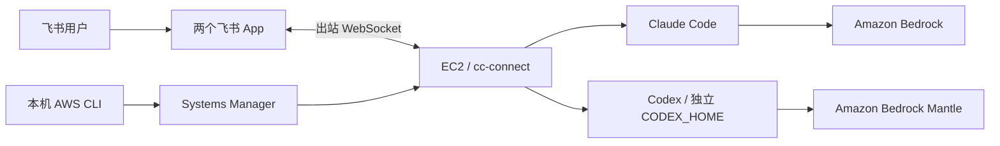

# cc-connect on AWS

在 EC2 上运行 [cc-connect](https://github.com/chenhg5/cc-connect)，通过两个飞书机器人分别使用 Claude Code 和 Codex。本机使用已有 AWS CLI 凭证，通过 Systems Manager（SSM）部署和维护；EC2 安全组无需开放入站端口。

这是个人实验项目。仓库提供 CloudFormation 主机模板、双机器人配置示例和运维工具。飞书应用、模型访问权限和凭证需要自行配置。



## 版本基线

以下组合于 **2026-09-30** 完成集成验证，**2026-10-12** 通过 SSM 复核安装版本及服务状态。机器可读记录在 [versions.json](versions.json)。Claude Code 和 Codex 使用已验证版本，不表示今天的 npm latest。

| 组件 | 版本 |
|---|---|
| cc-connect | 官方 npm `1.5.0` |
| Claude Code | `2.1.285` |
| Codex | `0.159.2` |
| Node.js | `22.x` |

服务直接运行 `/usr/bin/cc-connect`。不需要编译 cc-connect，也不需要自定义覆盖程序。

## 使用

1. 按 [部署说明](docs/deployment.md) 创建主机，配置两个飞书 App 和各自的访问名单。
2. 从 [examples](examples/) 复制配置，在实例上填入自己的模型、凭证和 App 信息。
3. 启动服务后，在两个机器人分别测试 `/whoami`、`/model` 和一次实际模型调用。
4. 按 [运维说明](docs/operations.md) 维护版本、模型、MCP、权限和项目目录。

CloudFormation 只初始化主机，**不会自动启用尚未配置的机器人**。更新模板也不等于在现有实例上重新执行初始化脚本。

## 配置边界

以下路径均位于 EC2：

| 路径 | 用途 |
|---|---|
| `~/.cc-connect/config.toml` | 两个 project、飞书 App、访问名单、活跃 provider 与模型 |
| `~/.cc-connect/agents/codex/config.toml` | Codex 机器人的 endpoint、凭证引用、MCP 和权限 |
| `~/.codex/` | 其他 Codex 客户端的配置和状态，单独维护 |
| `/etc/cc-connect.env` | 模型凭证，属主 `root:ec2-user`、权限 `0640` |
| `~/.config/systemd/user/cc-connect.service` | 唯一的机器人服务定义 |
| `~/workspaces/projects/<name>/` | 项目代码与学习材料 |
| `~/workspaces/research/<YYYY-MM-topic>/` | 调研资料 |

机器人模型只在 cc-connect 的活跃 provider 中维护。两个飞书 App 的 `open_id` 各自独立，不能复制同一个管理员 ID 到两个 project。

默认示例给 Codex 工作区写入权限；需要让它承担整机运维时，按 [整机权限配置](docs/operations.md#整机运维权限) 显式启用。项目目录约定不会自动切换会话工作目录，也不是权限隔离。

## 工具与校验

```bash
# 使用本机 AWS CLI 当前 profile 执行只读检查
python3 scripts/ssm-run.py scripts/inspect-host.sh --region us-east-1

# 本地校验，需要 Python 3.11+ 和 cfn-lint
python3 -m unittest discover -s tests -v
cfn-lint cc-connect-stack.yaml
bash -n scripts/inspect-host.sh
```

SSM 执行器会输出 command ID、状态和脚本结果。提交的脚本及输出会进入 SSM 记录，不要在脚本中嵌入密钥或输出完整配置、环境变量和聊天日志。

[legacy](legacy/README.md) 保存已停用的早期部署脚本，仅用于追溯。实例专属的迁移程序、备份、访问名单和审计记录不属于公共部署模板。
