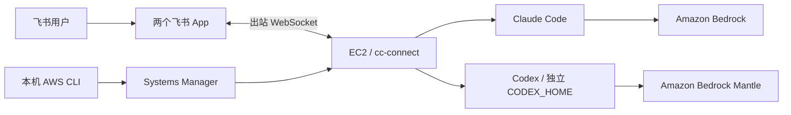

# cc-connect on AWS

在 EC2 上运行 [cc-connect](https://github.com/chenhg5/cc-connect)，通过两个飞书机器人分别使用 Claude Code 和 Codex。本机使用已有 AWS CLI 凭证，通过 Systems Manager（SSM）部署和维护；EC2 安全组无需开放入站端口。

这是个人实验项目。仓库提供 CloudFormation 主机模板、双机器人配置示例和运维工具。飞书应用、模型访问权限和凭证需要自行配置。

<table align="center">
  <tr>
    <td align="center"></td>
    <td align="center"></td>
  </tr>
  <tr>
    <td align="center"><sub>飞书里跟 Claude Code 对话</sub></td>
    <td align="center"><sub>用 cc-connect 自带的 <code>/model</code> 卡片切换 Bedrock 模型<br/>可选模型与别名在活跃 provider 中配置</sub></td>
  </tr>
</table>

演示录制于早期版本，展示飞书对话和模型切换流程；实际模型列表以当前配置为准。

- 两个飞书 App 分别连接 Claude Code 和 Codex，模型通过 Bedrock / Bedrock Mantle 调用。
- 飞书使用 WebSocket 长连接，无需向 EC2 开放入站端口或配置入站 Webhook。
- Claude 的 Bedrock API key 从 SSM SecureString 读取；Codex 使用独立凭证引用。
- 官方 npm 版本、统一 systemd 服务和独立 Codex home，减少配置相互覆盖。
- 可以在移动端阅读资料、维护代码、运行工具；项目文件保存在 EC2 的工作目录中。

## 架构

一个 cc-connect 进程可以运行多个 project。本仓库示例中，每个 project 对应一个 agent 和一个飞书 App，分别维护模型、管理员和访问名单。两个 agent 可以访问同一项目目录，Codex 的配置与会话状态使用独立 home。



## 版本基线

以下组合于 **2026-09-30** 完成集成验证，**2026-10-12** 通过 SSM 复核安装版本及服务状态。机器可读记录在 [versions.json](versions.json)。Claude Code 和 Codex 使用已验证版本，不表示今天的 npm latest。

| 组件 | 版本 |
|---|---|
| cc-connect | 官方 npm `1.5.0` |
| Claude Code | `2.1.285` |
| Codex | `0.159.2` |
| Node.js | `22.x` |

服务直接运行 `/usr/bin/cc-connect`。不需要编译 cc-connect，也不需要自定义覆盖程序。

## 使用

### 先决条件

- 本机已安装 AWS CLI v2 和 Session Manager plugin，`aws sts get-caller-identity` 能确认身份。
- EC2 子网具备访问 SSM、飞书、软件源和模型 API 的出站网络。
- 已准备目标区域可用的模型及 API key；Claude 和 Codex 的区域与凭证分别配置。
- 已创建两个飞书应用，启用机器人和长连接事件订阅并发布版本；接入细节见 [飞书指南](https://github.com/chenhg5/cc-connect/blob/v1.5.0/docs/feishu.md)。

### 部署入口

1. 按 [部署说明](docs/deployment.md) 创建主机，配置两个飞书 App 和各自的访问名单。
2. 从 [examples](examples/) 复制配置，在实例上填入自己的模型、凭证和 App 信息。
3. 启动服务后，在两个机器人分别测试 `/whoami`、`/model` 和一次实际模型调用。
4. 按 [运维说明](docs/operations.md) 维护版本、模型、MCP、权限和项目目录。

CloudFormation 只初始化主机，**不会自动启用尚未配置的机器人**。更新模板也不等于在现有实例上重新执行初始化脚本。

### 在飞书中试用

分别给两个机器人发送以下消息，确认身份、模型列表和实际调用：

```text
/whoami
/model
hi
```

`/model` 卡片展示当前 provider 的可选模型，也可以用 `/model switch <alias>` 切换已配置的别名。管理员 ID 要从对应的 App 获取。

接下来可以直接指定 EC2 上的项目目录，例如：

```text
请阅读 /home/ec2-user/workspaces/projects/aws-sap-02 中的学习资料，
先列出已有内容，再帮助我制定今天的学习计划。
```

开发任务也应明确文件放在哪里，例如“把项目放在 `/home/ec2-user/workspaces/projects/my-app`”。目录不存在时，先让机器人确认任务并创建它。

## 文件清单

| 文件 | 作用 |
|---|---|
| [cc-connect-stack.yaml](cc-connect-stack.yaml) | 创建 EC2、IAM、安全组及服务，读取已有 SSM 参数并安装官方软件 |
| [versions.json](versions.json) | 软件版本基线与验证日期 |
| [examples/cc-connect.example.toml](examples/cc-connect.example.toml) | 双 project、独立飞书 App、模型和访问名单示例 |
| [examples/codex.example.toml](examples/codex.example.toml) | Codex 独立 home 中的 provider、凭证引用与权限示例 |
| [examples/cc-connect.env.example](examples/cc-connect.env.example) | 实例环境变量名称及占位符 |
| [scripts/ssm-run.py](scripts/ssm-run.py) | 使用本机 AWS CLI 凭证提交已审阅的 SSM 脚本 |
| [scripts/inspect-host.sh](scripts/inspect-host.sh) | 只读检查版本、服务和配置摘要 |
| [docs/deployment.md](docs/deployment.md) / [docs/operations.md](docs/operations.md) | 部署、升级、恢复、模型、MCP 和整机权限说明 |
| [legacy](legacy/README.md) | 已停用的早期初始化和修补脚本，保留追溯用途 |

## 配置边界

以下路径均位于 EC2：

| 路径 | 用途 |
|---|---|
| `~/.cc-connect/config.toml` | 两个 project、飞书 App、访问名单、活跃 provider 与模型 |
| `~/.cc-connect/agents/codex/config.toml` | Codex 机器人的 endpoint、凭证引用、MCP 和权限 |
| `~/.codex/` | 其他 Codex 客户端的配置和状态，单独维护 |
| `/etc/cc-connect.env` | 模型凭证，属主 `root:ec2-user`、权限 `0640` |
| `~/.config/systemd/user/cc-connect.service` | 唯一的机器人服务定义 |
| `~/workspaces/projects/<name>/` | 项目代码与学习材料 |
| `~/workspaces/research/<YYYY-MM-topic>/` | 调研资料 |

机器人模型只在 cc-connect 的活跃 provider 中维护。两个飞书 App 的 `open_id` 各自独立，不能复制同一个管理员 ID 到两个 project。

默认示例给 Codex 工作区写入权限；需要让它承担整机运维时，按 [整机权限配置](docs/operations.md#整机运维权限) 显式启用。项目目录约定不会自动切换会话工作目录，也不是权限隔离。

## 常见问题

| 现象 | 检查与处理 |
|---|---|
| 退出 SSM 后机器人停止运行 | 确认 `ec2-user` 已启用 lingering，且 `cc-connect.service` 已 enable；模板会配置 lingering |
| Claude Code 提示 `Not logged in / Please run /login` | 检查 Claude provider 的 Bedrock 配置及服务的 `EnvironmentFile`；systemd 不会读取交互式 shell 的 profile |
| 模型 API 返回 `The provided model identifier is invalid` | 检查账号、区域和 endpoint 支持的完整模型 ID；provider 的 `model` 写实际 ID，短别名用于 `/model` 切换 |
| `/model` 显示默认模型，而不是自己配置的列表 | 确认 `agent.options.provider` 指向正确 provider，并检查服务日志中的 provider 激活记录 |
| 改了配置，实际调用的模型却没变 | 只在活跃 provider 中维护默认模型，排查重复的 `options.model`、全局模型设置及 Claude 的过时 `availableModels` |
| Codex 机器人和其他 Codex 客户端相互影响 | 检查 `codex_home` 和服务 `CODEX_HOME` 均指向 `~/.cc-connect/agents/codex` |
| 同一个人的消息在另一个机器人中被拒绝 | 飞书 `open_id` 按 App 隔离，分别核对该 App 的管理员和访问名单 |

完整排查及恢复步骤见 [运维说明](docs/operations.md)。

## EC2 上的工作目录约定

这是个人使用中保留下来的习惯：开发项目、学习材料和临时调研分开放，方便在飞书里交代任务，也方便回头查找。

```text
~/workspaces/
├── projects/
│   ├── cc-connect-on-aws/       # 开发项目尽量与 GitHub 仓库同名
│   └── aws-sap-02/              # 学习资料也可以作为独立项目维护
└── research/
    ├── 2026-10-topic/           # 按日期组织调研、读仓库和笔记
    └── INDEX.md                # 每个调研一行摘要和目录链接
```

- 调研目录通常使用 `YYYY-MM-topic`；长期积累的主题可以用固定名称。
- 临时调研默认不 `git init`；需要持续开发和提交的内容放到 `projects/<repo>/`。
- 每增加一个调研，就在 `research/INDEX.md` 追加摘要。问“以前调研过什么”时，让 agent 先读索引。
- 把目录约定写进 agent 的指令或适用的 `AGENTS.md`，并在任务中明确目标路径。

新配置示例以 `~/workspaces/projects` 为初始 `work_dir`；历史实例可能仍使用 `~/workspaces/my-project`。cc-connect 不会按任务名称自动切换目录，现有实例以自己的配置为准。两个 agent 协作时，避免同时修改同一文件。

## 工具与校验

通过本机 AWS CLI 进入实例：

```bash
INSTANCE_ID=$(aws cloudformation describe-stacks \
  --stack-name cc-connect --region us-east-1 \
  --query "Stacks[0].Outputs[?OutputKey=='InstanceId'].OutputValue" --output text)
aws ssm start-session --target "$INSTANCE_ID" --region us-east-1
```

也可以直接提交只读检查，或在本地校验仓库：

```bash
# 使用本机 AWS CLI 当前 profile 执行只读检查
python3 scripts/ssm-run.py scripts/inspect-host.sh --region us-east-1

# 本地校验，需要 Python 3.11+ 和 cfn-lint
python3 -m unittest discover -s tests -v
cfn-lint cc-connect-stack.yaml
bash -n scripts/inspect-host.sh
```

SSM 执行器会输出 command ID、状态和脚本结果。提交的脚本及输出会进入 SSM 记录，不要在脚本中嵌入密钥或输出完整配置、环境变量和聊天日志。

[legacy](legacy/README.md) 保存已停用的早期部署脚本，仅用于追溯。实例专属的迁移程序、备份、访问名单和审计记录不属于公共部署模板。

## 费用

费用主要来自 EC2、EBS、模型调用和网络资源。当前模板默认 `m8i.2xlarge`、50 GiB gp3；旧版按 `t3.large`、30 GiB 估算的月费不再适用，应按所选实例、区域和实际模型用量计算。

不用时可停止实例；EBS、保留的公网 IPv4 地址等资源仍可能产生费用。删除实例前，先将项目与会话备份到实例之外。

## 参考

- [cc-connect 项目](https://github.com/chenhg5/cc-connect)
- [飞书自建应用接入指南（cc-connect 1.5.0）](https://github.com/chenhg5/cc-connect/blob/v1.5.0/docs/feishu.md)
- [Claude Code on Amazon Bedrock](https://code.claude.com/docs/en/amazon-bedrock)
- [Amazon Bedrock API Keys](https://docs.aws.amazon.com/bedrock/latest/userguide/api-keys-generate.html)
- [AWS Systems Manager Session Manager](https://docs.aws.amazon.com/systems-manager/latest/userguide/session-manager.html)
